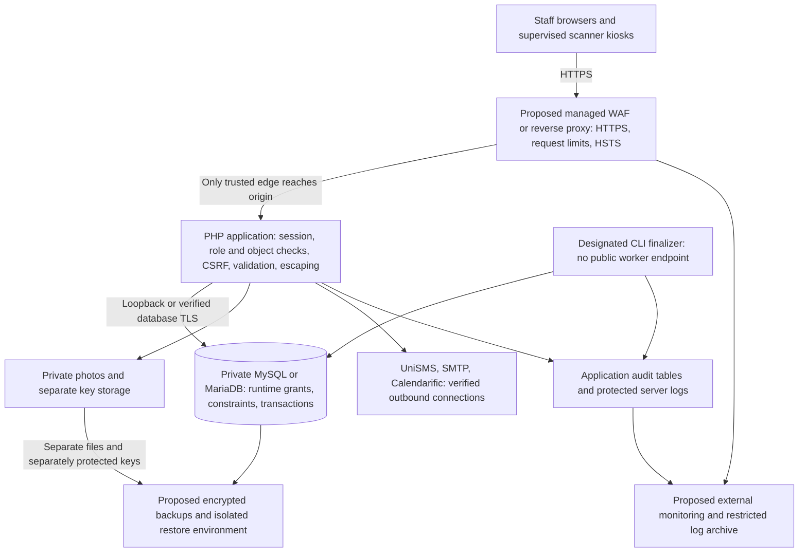

# Cybersecurity Plan for the Student Attendance System

**Republic of the Philippines**  
**Laguna State Polytechnic University**  
**College of Computer Studies**  
**ITEP 413 - Information Assurance and Security 2**  
**Final Project: Cybersecurity Plan for Your Capstone System**

| Report information | Details |
| --- | --- |
| Capstone system | QR-Based Student Attendance System for San Pablo City Central School |
| Group name and members | To be supplied by the capstone group |
| Instructor / section | To be supplied by the capstone group |
| Prepared | 25 October 2026, Asia/Manila |
| Basis | Current repository source, schema, security documentation, and the ITEP 413 assignment |

## Scope and evidence statement

This plan addresses the six written sections in the final-project brief. It describes the actual PHP attendance application and proposes improvements where the repository does not establish an operational control. The school name is the application's default; the group should use its approved capstone title on the final cover.

**Implemented** means code or configuration exists in this checkout. **Deployment verification required** means an operator must demonstrate that the control is enabled on the actual host. **Proposed** means a recommendation in this report, not a completed system feature. Source inspection is not a penetration test, proof of production configuration, or evidence that every existing test currently passes.

This Markdown document is the requested editable answer. The assignment's final submission calls for an 8-15-page Word or PDF report, excluding the cover and references. Pagination depends on the final LSPU formatting; add group details, render the architecture diagram, and verify page numbers and length when exporting. No production changes are authorized or performed by this plan.

## 1. System Overview and Asset Inventory

### 1.1 Purpose and users

The application manages elementary-school attendance from Kinder through Grade 6. Authorized personnel register student profiles, assign sections and advisers, generate QR cards, record arrival and departure, review incomplete attendance, and produce school reports. Parents or guardians receive configured notifications; they do not have a parent login role in the inspected schema.

Daily attendance requires two valid scans according to the section schedule. AM half-day uses morning arrival and departure; PM half-day uses afternoon arrival and departure; full day uses morning arrival and afternoon departure. A missing departure remains partial. Scan windows, late thresholds, school-calendar exclusions, and manual review determine how records are handled. Historical AM/PM columns remain for compatibility. See [README](../README.md), [scan processing](../attendance/scan_process.php), and [scan transaction logic](../includes/attendance_scan.php).

The repository also supports permanent student identity, annual enrollment, dated section assignments, moving up, school-year activation, and reviewed enrollment corrections. These features are conditional on the managed enrollment model being initialized. Their presence does not prove that the live installation has completed cutover. Preparing next year's enrollment must preserve current and historical attendance. See [annual enrollment operations](SCHOOL_YEAR_ENROLLMENT.md).

### 1.2 Components and assets

| Asset / component | Actual contents or function | Security importance |
| --- | --- | --- |
| PHP web application | Login, dashboard, students, sections, scanner, attendance, reports, analytics, calendar, settings, and audit interface | A compromised application can expose records and alter attendance |
| Browser client and camera | HTML/CSS/JavaScript, Bootstrap, Chart.js, and html5-qrcode; camera-based QR reading | Shared kiosks and downloaded reports are exposure points |
| MySQL/MariaDB database | Student, account, attendance, section, calendar, enrollment, notification, and audit tables | Central source of attendance and personal information |
| Student profiles | LRN, name, gender, birth date, address, photo reference, QR token, and parent details | Restricted learner and family information |
| Attendance and enrollment | Scan times, daily status, remarks, school years, placements, and corrections | Integrity affects reports and school decisions |
| Accounts and sessions | Password hashes, roles, active status, session tokens, and session metadata | Establish authority to read and change records |
| Private photo storage | Student images served through an authorized PHP handler | Direct public file access must remain blocked |
| Cryptographic keys and provider secrets | PII/history key, settings key, database credentials, SMS key, and SMTP credentials | Loss can prevent recovery; disclosure can enable misuse |
| Notifications | UniSMS requests, SMTP email, recipient details, and SMS delivery logs | Incorrect recipients or duplicate sends can disclose information |
| Holiday integration | Calendarific HTTPS requests and administrator-triggered imports | Untrusted responses must be validated before calendar changes |
| CLI worker and migrations | Attendance finalizer, schema changes, enrollment inventory/mapping/cutover tools | Require controlled identities, execution, and private output storage |
| Source, dependencies, and CI | Composer/npm manifests, local JavaScript inventory, tests, and GitHub workflow | Supply-chain and release integrity |
| Backups and exports | Database recovery copies, uploaded files, keys stored separately, PDF/Excel reports | Sensitive copies may outlive their original purpose |

The PHP platform requirement is at least PHP 8.1 in [composer.json](../composer.json). This minimum does not establish that a particular installed PHP release remains supported; production must use a maintained branch and current patches. The application uses a relational database through PDO. There is no separate native mobile client or payment-processing component evident in this scope. Evidence: [schema](../attendance_system.sql), [browser inventory](../package.json), [mail helper](../includes/mail_helper.php), and [Calendarific integration](../includes/calendarific.php).

### 1.3 Roles and access levels

| Role / actor | Authorized access | Main boundary |
| --- | --- | --- |
| Administrator | School-wide staff functions, account management, settings, school years, reviewed corrections, and security audit | Privileged actions require authenticated server-side authorization |
| Teacher | Staff functions within assigned sections, scoped attendance/reports and permitted schedule updates | Cannot gain access by changing student or section IDs; End of Day Review is teacher-only for assigned active sections |
| Scanner operator | School-wide scanning and the limited scanner workflow | Cannot open staff attendance management, reports, analytics, calendar, private photos, or security audit |
| Unauthenticated visitor | Login page | Public account registration is disabled; no student-record access |
| CLI worker / migration operator | Designated attendance finalization or separately authorized migration operations | Not an interactive user role; runtime and schema-owner privileges must be separate |
| Student / guardian | Presents a QR card or receives a notification | Does not obtain staff application privileges |

Administrators can scan, but the teacher-only End of Day Review is a specific exception to general administrative breadth. Historical enrollment-report access follows a section's **current adviser**, including archived sections where authorized, rather than automatically granting every former adviser continued access. This rule needs review whenever advisers change. Evidence: [role guards](../includes/functions.php), [enrollment access](../includes/enrollment_access.php), [disabled registration](../register.php), and [end-of-day documentation](../README.md).

### 1.4 Data flows and protection objectives

1. A staff member signs in; the server verifies the password and creates a revocable session.
2. The authenticated scanner submits a QR token with a CSRF token. The server resolves the student and current placement, checks scope and schedule, and writes the permitted event transactionally.
3. After a successful scan commit, the application may attempt configured parent notifications. Provider acceptance is distinct from confirmed handset receipt.
4. Teachers and administrators retrieve permitted records and reports. Exports become separately controlled copies once downloaded.
5. A designated CLI worker finalizes eligible attendance without requiring someone to open a page. The finalizer does not send parent notifications.
6. Auditable changes preserve encrypted before/after history; authorized administrators review events and flagged activity.

Confidentiality protects learners and families. Integrity preserves reliable scans, placements, and reports. Availability supports arrival and dismissal operations; during an outage, designated staff should maintain a controlled temporary attendance record for later reconciliation without inventing scan timestamps.

## 2. Risk and Threat Assessment

### 2.1 Method

The assessment uses [OWASP Top 10:2025](https://top10.owasp.org/2025/), as specified by the assignment. Likelihood considers current code controls and realistic school usage; impact considers learner-data disclosure, false attendance, notification misuse, and interruption. High means plausible exposure or serious harm; Medium means a credible scenario requiring additional conditions; Low means a constrained scenario with comparatively limited effects. These are qualitative planning judgments, not measured exploit probabilities. Every risk below has High impact because it can affect sensitive records, authority, or school-wide service; likelihood distinguishes priority.

### 2.2 Repository-specific risk register

| ID | Threat and OWASP 2025 category | Likelihood | Impact | Reason based on actual design | Treatment |
| --- | --- | --- | --- | --- | --- |
| R1 | Cross-section record access or bulk report disclosure - A01 Broken Access Control | Medium | High | Many endpoints accept student/section IDs. Shared guards and scoped repositories reduce risk, but every read, export, photo, and write needs consistent checks | C1, C4, C9 |
| R2 | Exposed dump, key, upload, migration, or development configuration - A02 Security Misconfiguration | Medium | High | Apache deny rules and deployment validation exist; protection depends on actual server rules, private directories, grants, and proxy configuration | C5, C6, C10 |
| R3 | Compromised package, browser library, or build action - A03 Software Supply Chain Failures | Medium | High | PHP and JavaScript dependencies execute trusted code. Lockfiles, local JS hashes, SRI, and CI exist, but workflow execution and merge enforcement are operational settings | C7 |
| R4 | Database/backup disclosure or encryption-key loss - A04 Cryptographic Failures | Medium | High | SF2 remarks, change history, and selected settings use encryption; ordinary student/contact fields are not all field-encrypted. Recovery depends on preserved keys and files | C6, C10 |
| R5 | SQL injection or stored/reflected XSS - A05 Injection | Medium | High | Names, remarks, filters, and imports cross trust boundaries. Parameterized queries and output escaping exist; inline JavaScript remains allowed by CSP | C4, C5 |
| R6 | Copied QR card used as attendance evidence - A06 Insecure Design | High | High | A static card can be photographed or shared. Token randomness prevents guessing but cannot prove the named student is physically present | C3 |
| R7 | Password compromise or unattended kiosk session - A07 Authentication Failures | Medium | High | Password login, quotas, expiration, and revocation exist. MFA is absent and the current password policy allows 8-16 characters | C2, C3 |
| R8 | Duplicate or improperly corrected attendance/year transitions - A08 Software or Data Integrity Failures | Medium | High | Concurrent scans and enrollment transitions change linked records. Unique keys, row locks, transactional audit, and reviewed activation help; partial releases remain hazardous | C8, C10 |
| R9 | Attack or provider failure overlooked - A09 Security Logging and Alerting Failures | Medium | High | Application events and in-app alerts exist, but no external security-alert transport is configured; early server failures need independent monitoring | C9 |
| R10 | Outage or exception leaves unreliable service state - A10 Mishandling of Exceptional Conditions | Medium | High | Session/quota failures return 503; scan contention is retried within bounds. Worker scheduling, external-provider timeouts, and disk/key failures still need operational response | C8, C9, C10 |

The highest immediate attention goes to exposed infrastructure/secrets, suspicious privileged activity, and QR supervision. A functioning WAF cannot replace object authorization. Encryption cannot make a compromised running application trustworthy. Each treatment must be verified at the layer that enforces it.

## 3. Security Controls and Architecture

### 3.1 Architecture and trust boundaries

The diagram distinguishes application controls from the proposed deployment perimeter. Hosting documentation exists, but this report has not inspected a production server or confirmed a deployed WAF.

### 3.2 C1 - Enforce least privilege and object authorization

**Implemented; deployment grants require verification.** Apply login, role, active-account, and section/enrollment checks on the server for every endpoint. Never accept a posted user ID as the actor. Teachers remain within permitted section scope; scanner accounts retain their restricted workflow even if they know another page's URL. Bulk exports require the same scope as individual views. Private photos use `student_photo.php`, with authorization and no-store responses.

Recheck authority during sensitive transactions, particularly when a section adviser, account status, or annual placement may change concurrently. Use a dedicated runtime database account with only required operations and separate migration credentials. Audit tables should permit runtime SELECT/INSERT only; database-wide grants must not override the intended restriction. This addresses R1 and limits R2/R7 damage. See [access checks](../includes/student_access.php), [annual write checks](../includes/enrollment_access.php), and [audit deployment requirements](SECURITY_AUDIT.md).

### 3.3 C2 - Strengthen authentication and session management

**Implemented baseline.** Passwords are verified using PHP password APIs; account creation/reset paths store hashes. Public registration returns 403. Login quotas include IP, normalized username, and actual account identity when found. Single-session enforcement replaces the previous session. Login regenerates the PHP session ID, and protected requests validate the database token and current account authority.

Session cookies use strict mode, cookies only, HttpOnly, SameSite=Lax, and host-only scope. Secure cookies are required in production. Default administrator/teacher idle and absolute lifetimes are 30 minutes and 8 hours; scanner defaults are 4 hours and 12 hours. Polling does not extend idle activity. Password, role, and status changes revoke sessions. Validation outages fail closed with generic 503 responses. Evidence: [session policy](SESSION_SECURITY.md), [session implementation](../includes/session_security.php), and [login](../index.php).

**Proposed.** Add a vetted MFA solution for privileged users, protect hosting/repository accounts with MFA, and replace the restrictive 16-character password ceiling with a reviewed long-passphrase policy compatible with the chosen hashing implementation. Include compromised-password screening and a documented identity-verification process for resets. These recommendations require implementation and regression checks; they are not existing protections. C2 addresses R7 and reduces R1 exposure after credential theft.

### 3.4 C3 - Supervise scanners and handle lost cards

**Implemented baseline.** Scanner requests require authentication, CSRF validation, scope checks, and shared quotas. New QR tokens have a cryptographically random suffix, but the LRN remains in the token. Tokens and printed cards therefore need personal-data handling. Existing cards remain valid until deliberately rotated; new-token generation does not retroactively upgrade old cards.

**Proposed operating procedure.** Assign one named scanner account per kiosk, position the device where staff can supervise the learner presenting a card, restrict kiosk access to other applications, and lock the device outside attendance periods. Staff must not treat a QR scan alone as proof of identity. On a lost/shared card, an authorized operator should use the documented single-student CLI rotation process, reissue the card, and review suspicious scans. Avoid school-wide token rotation unless incident scope justifies the disruption. C3 addresses R6 and R7. See [abuse and QR controls](SECURITY_ABUSE_CONTROLS.md).

### 3.5 C4 - Validate requests, uploads, and outputs

**Implemented baseline.** State-changing authenticated actions use POST and a server-validated session-bound CSRF token. SameSite cookies supplement that check. PDO placeholders protect data values; dynamic SQL identifiers require fixed allowlists. Validate IDs, dates, school-year relationships, token lengths, and required fields before mutation. Encode untrusted text for its HTML/JavaScript context; client validation is a usability measure, not authority.

Photo processing verifies upload provenance, actual size, supported image decoding, dimension/pixel bounds, and re-encodes to JPEG/PNG with a random filename. Store images privately and serve approved image MIME types through the authorized handler. Calendarific imports validate provider responses and preserve existing entries. C4 treats R1/R5 and reduces malicious-file exposure under R2. See [CSRF helper](../includes/csrf.php), [photo handling](../includes/student_photos.php), and [deployment controls](DEPLOYMENT_SECURITY.md).

### 3.6 C5 - Browser headers, HTTPS, WAF, and firewall placement

**Implemented headers.** [The shared header helper](../includes/browser_security.php) sets:

| Header / policy | Current value or restriction | Purpose and limitation |
| --- | --- | --- |
| Content-Security-Policy | `script-src 'self' 'unsafe-inline'`; `object-src 'none'`; `base-uri 'self'`; `frame-ancestors 'self'`; `form-action 'self'`; `worker-src 'self' blob:` | Restricts external executable scripts and dangerous embedding; inline scripts remain a residual XSS risk |
| X-Content-Type-Options | `nosniff` | Prevents MIME sniffing |
| Referrer-Policy | `same-origin` | Limits cross-origin referrer disclosure |
| Cache-Control | Sensitive/login/session responses use no-store/no-cache controls | Reduces shared-browser exposure; verify endpoint coverage |

**Proposed / deployment verification required.** Terminate HTTPS at a controlled edge and add HSTS only after HTTPS and certificate renewal are verified. Place a managed WAF before the PHP origin to filter known exploit patterns and rate-limit abusive traffic. If hosting supports origin allowlists, accept backend web traffic only from that edge; otherwise use the host's available origin-protection mechanism and document its limits. Configure only exact trusted proxy addresses and overwrite forwarded headers. Do not expose MySQL publicly; allow only necessary application/worker connections. Limit administrative access through MFA and a restricted management path.

Test WAF rules against scanner bursts, image uploads, exports, and session expiry to avoid blocking legitimate school activity. Use report-only evaluation when tightening CSP, then replace inline handlers with reviewed external scripts/nonces. Scope browser camera permission to the scanner where practical. These controls address R2/R5/R10. WAF/network products are proposed infrastructure, not repository features.

### 3.7 C6 - Protect secrets and stored data

**Implemented baseline.** Selected integration secrets and SF2/change-history content use AES-256-GCM. Photo files move outside the document root. Schema imports contain no seeded school records or default accounts. Apache rules deny internal folders, dumps, archives, keys, and direct legacy-photo access; equivalent rules are necessary on another server. Verified HTTPS protects provider calls, while production remote database connections require configured CA validation and an established TLS cipher. See [PII storage](PII_STORAGE.md), [settings security](../config/SETTINGS_SECURITY.md), and [deployment security](DEPLOYMENT_SECURITY.md).

**Proposed / verification required.** Confirm encryption for database volumes, photos, exports, and backups with the host. Store the PII key and settings key separately from database dumps with restricted access and recovery copies. Do not replace the PII key casually: old remarks/history become unreadable. Review repository history and old release archives privately because earlier commits may retain historical dumps; present schema-only files do not prove historical removal. Never place secrets, student samples, or real exports in a report or public issue. C6 addresses R2/R4.

### 3.8 C7 - Control dependencies and releases

**Implemented baseline.** Composer/npm lockfiles support reproducible dependency review. Locally served browser JavaScript has an inventory with SHA-384 hashes and matching SRI attributes. The security workflow checks dependency advisories, browser integrity, and reviewed PHP support dates, with third-party actions pinned to commits.

**Proposed / verification required.** Enable the workflow, require its checks through branch protection, review dependency changes, and record release hashes. Investigate unexpected hash changes rather than merely regenerating expected hashes. Review advisories on each release and on scheduled runs, and test scanner/charts after updates. Historical audit results are not current vulnerability findings. C7 addresses R3. Evidence: [security workflow](../.github/workflows/security.yml), [vendor inventory](../assets/vendor/manifest.json), and [audit documentation](SECURITY_AUDIT.md).

### 3.9 C8 - Preserve transaction and enrollment integrity

**Implemented baseline.** Attendance uses a unique student/date key, transactional upsert and row locking, a five-minute duplicate-scan cooldown, fixed event-column choices, and bounded retries for database contention. Critical mutations include audit history in the transaction; failure rolls the mutation back before notifications. Send external notifications after commit and report failed/unknown outcomes rather than claiming exactly-once delivery.

Annual enrollment adds unique student/year ownership, dated assignments, guarded activation, and preview/confirmation for sensitive historical corrections. Preserve scan values and closed-year history. Deploy the complete converted release, drain web writes and old workers before initialization, and verify recoverability before cutover. C8 addresses R8/R10. Evidence: [scan transactions](../includes/attendance_scan.php), [schema](../attendance_system.sql), and [cutover instructions](SCHOOL_YEAR_ENROLLMENT.md).

### 3.10 C9 - Record events and monitor independently

**Implemented baseline.** Security events track actor, action, outcome, route, request ID, and alerts; encrypted histories support review of changes. Application alerts identify flagged activity and repeated failed login/scanner requests. Audit UPDATE/DELETE triggers restrict ordinary alteration but cannot stop a privileged database owner. Critical history failures block writes; request telemetry is best effort and emits a generic private-log signal if audit storage is unavailable.

**Proposed.** Add independent availability/job monitoring, protected edge logs, an externally administered log archive, and an alert channel for responsible staff. Exclude passwords, session/QR tokens, provider keys, raw request bodies, and unnecessary learner details. Alert on audit-storage failures, abnormal exports, account/contact changes, worker staleness, and unexpected integrity failures. C9 addresses R9 and supports all incident investigations. See [audit behavior and limitations](SECURITY_AUDIT.md).

### 3.11 C10 - Recover safely and maintain availability

**Existing operational guidance; automation proposed.** Run the CLI finalizer every minute under one designated scheduler and monitor exit status/cursor progression. Scheduling is not installed merely by deploying source. Do not expose the worker as an HTTP endpoint.

Implement encrypted daily database backups, separate photo/upload preservation, and separately protected keys. The panel roadmap proposes 30 days of daily backups and 12 monthly snapshots; these are planning targets, not evidence of an installed backup feature or an approved live-record deletion policy. Keep a protected off-server copy. An initial proposed recovery target is at most one school day of data loss and restoration within one working day; school management must approve feasibility, and restore exercises must measure it.

Restore to an isolated environment with notifications disabled. Verify tables, keys/indexes, audit triggers, decrypted remarks/history, representative photos, and report totals. After new-model writes, rollback requires reconciliation or an explicitly assessed snapshot restore; toggling a flag cannot preserve discarded writes. C10 addresses R2/R4/R8/R10. See [deployment operations](DEPLOYMENT_SECURITY.md), [enrollment recovery](SCHOOL_YEAR_ENROLLMENT.md), and [future backup scope](superpowers/specs/2026-10-22-panel-revisions-roadmap.md).

## 4. Standards Alignment

### 4.1 ISO/IEC 27002:2022

The plan uses the standard as control guidance. Its four themes are organizational, people, physical, and technological. This mapping is an interpretation for this system, not a certification claim. ISO/IEC 27002 provides guidance; ISO/IEC 27001 addresses certifiable ISMS requirements. See [ISO's standard overview](https://www.iso.org/standard/75652.html) and the [standards preview](https://gso-sims-preview-doc-aws.s3-eu-west-1.amazonaws.com/iso-iec-27002-2022-en.html).

| Theme and control reference | Application of this plan | Evidence to retain |
| --- | --- | --- |
| Organizational - 5.9 asset inventory; 5.12 classification | Section 1 inventories records, keys, providers, devices, and copies | Reviewed inventory and designated owners |
| Organizational - 5.15 access control; 5.18 access rights | C1/C2 restrict accounts and section scope | Permission review and revocation records |
| Organizational - 5.24-5.28 incident handling and evidence | Section 5 assigns response duties and preserves evidence | Exercise results and incident register |
| People - 6.3 awareness and training; 6.8 event reporting | C3 and Section 6 train staff to recognize phishing and report anomalies | Training attendance and reporting procedure |
| Physical - 7.7 clear screen; 7.8 equipment protection | C3 supervises kiosks and secures unattended devices | Device checklist and inspection record |
| Technological - 8.5 secure authentication | C2 uses password hashing, session checks, and proposed MFA | Authentication/revocation checks |
| Technological - 8.13 backup | C10 preserves recoverable data, files, and keys | Restricted backup manifest and restore results |
| Technological - 8.15 logging; 8.16 monitoring | C9 combines application and independent telemetry | Access-controlled logs and reviewed alerts |
| Technological - 8.20 network security; 8.24 cryptography | C5/C6 protect traffic, secrets, and storage | Network rules and TLS/key-access verification |

### 4.2 PCI DSS applicability

PCI DSS is outside the assessed application's scope: no payment acceptance, cardholder-data storage/transmission, or connection to a cardholder-data environment is evident in the repository. SMS-service credentials and attendance records are not payment-card data. This is a system-scope conclusion, not an exemption for every activity of the school. Reassess if payment functions or connectivity to payment systems are introduced, including outsourced processing. See [PCI SSC scope guidance](https://www.pcisecuritystandards.org/merchants/).

## 5. Incident Response and Monitoring

### 5.1 Detection and review schedule

The following review schedule is proposed for school operations; the application currently provides in-app alerts rather than an external security operations service.

| Signal | Source | Review / escalation |
| --- | --- | --- |
| At least 10 unsuccessful login/scanner requests in 15 minutes | Existing audit-page highlight | Administrator reviews promptly; distinguish mistakes from hostile probing |
| Privileged account, parent-contact, bulk report, or QR activity | Flagged application events | Check against authorized tasks each school day; investigate unexplained activity immediately |
| Audit-storage failure or repeated 503 responses | Protected PHP/server logs and proposed monitor | Notify technical lead promptly; determine whether critical writes are failing closed |
| Finalizer failure or stale cursor | Scheduler status and `attendance_absence_last_date` | Check each operating day; compare date/section windows before correcting records |
| Failed/unconfirmed parent notifications | SMS/provider outcomes | Assigned staff follow up directly; do not blindly resend unknown outcomes |
| Unexpected library hash or advisory-check failure | CI and integrity checks | Stop release pending investigation and documented disposition |
| Missing backup or failed isolated restore | Proposed backup/restore monitor | Escalate to technical lead and school owner |

Security monitoring must account for shared school IPs and legitimate arrival bursts. A flagged event is evidence to assess, not proof of an attack. Synchronize system clocks and record investigation times in Asia/Manila with offset and request IDs.

### 5.2 Responsibilities

| Responsible function | Duties |
| --- | --- |
| School head / designated system owner | Authorizes service restrictions, recovery priorities, and acceptance of remaining risk |
| System administrator / technical lead | Triage, account/session containment, log preservation, host/provider coordination, and technical recovery |
| School privacy officer / DPO | Evaluates learner impact, applicable notification duties, and communications with the controller and authorities |
| Developer / maintainer | Identifies root cause, prepares reviewed fixes, and verifies affected behavior in isolation |
| Teacher / scanner custodian | Reports anomalies, preserves relevant observations, follows temporary attendance procedures |
| Hosting/service provider contact | Supplies protected infrastructure evidence and performs provider-side containment as authorized |

These are proposed assignments. Before operation, the school must name primary and alternate contacts and maintain their contact details in a restricted register, outside public source control. If one person holds multiple functions, record approvals and seek independent review of privileged actions where feasible.

### 5.3 Response procedure

1. **Identify and triage.** Create an incident ID and record discovery time, reporter, symptoms, request IDs, and affected components. Classify suspected learner-data disclosure, privileged takeover, or active record manipulation as urgent. Preserve evidence while determining whether a report is a fault, a security incident, or a personal-data breach.
2. **Contain.** For an account incident, deactivate the affected identity and verify token revocation. Restrict affected endpoints or origin access if exploitation continues. For a lost QR card, revoke/reissue the specific token through the controlled workflow. For notification misuse, pause the affected integration while preserving delivery evidence. Avoid deleting records or resetting infrastructure before evidence is collected unless necessary to stop immediate harm.
3. **Preserve and scope.** Collect authorized log extracts, relevant database snapshots, release hashes, timestamps, and provider references in encrypted restricted storage. Record collector, time, hash, transfer, and recipient for chain of custody. Correlate application and edge events; request events alone do not prove a mutation. Do not paste full learner records into tickets or public repositories.
4. **Eradicate.** Patch the responsible code/configuration, remove unauthorized access, and rotate actually exposed credentials. If a data-encryption key is compromised, plan controlled re-encryption and recovery rather than deleting it. Review whether altered parent contacts, privileges, or placements created persistence.
5. **Recover.** Rebuild from a trusted release, restore only from a verified recovery point if necessary, reconcile legitimate later records, and test access boundaries, scans, audit writes, and report totals. Keep outbound providers disabled during restore testing. The owner authorizes reopening after the technical lead and privacy officer assess remaining concerns.
6. **Learn.** Record root cause, affected scope, corrections, notification decisions, residual risks, and assigned actions. Conduct a tabletop exercise each term and an isolated restore exercise on a school-approved schedule; use synthetic data for training.

For example, if a teacher unexpectedly downloads records from another section, preserve the request and export evidence, revoke the account if compromise is suspected, check object-scope enforcement, and identify actual accessed learners before deciding notification scope. Blocking one IP alone would not resolve the authorization failure.

### 5.4 Reporting and documentation

An incident record should contain the incident ID, known/estimated occurrence and discovery times, systems and data categories, affected counts, evidence locations and hashes, response decisions/approvals, service interruption, recovery validation, notification assessment, and follow-up owners. Keep facts separate from hypotheses and restrict access to the response team.

For mandatory Philippine breach notification, the privacy officer must assess the applicable elements: sensitive information or information enabling identity fraud, suspected unauthorized acquisition, and a likely real risk of serious harm. Where notification is required, act within the applicable 72-hour period from knowledge or reasonable belief, based on available facts; do not wait for a complete forensic investigation. Use current NPC reporting procedures and record decisions for incidents not requiring mandatory notification. See [NPC breach-reporting guidance](https://privacy.gov.ph/pips-and-pics/breach-reporting/).

## 6. Compliance, Governance, and Fortinet Tie-In

### 6.1 Privacy obligations

The system processes identifiable learners and guardians. Education-related information is sensitive personal information under RA 10173. Processing therefore needs an appropriate legal basis, transparency, purpose limitation, proportionality, security, and supported data-subject rights. The school's designated privacy function should confirm the controller/processor roles and applicable lawful bases; consent should not be assumed to be the only basis. See [Republic Act No. 10173](https://elibrary.judiciary.gov.ph/thebookshelf/showdocs/2/50253), particularly Sections 3, 11-13, 16, and 20-21.

The following proposed operating rules apply those principles to the repository's workflows:

- Publish an understandable privacy notice describing attendance, QR cards, parent messaging, providers, retention, and contact channels.
- Collect only necessary profile/contact fields. Verify guardian recipients before enabling messages and review logged parent-contact changes promptly.
- Complete a privacy impact assessment before wider deployment and before new sensitive features. Use synthetic or properly de-identified records for demonstrations.
- Approve a documented retention schedule for live records, SMS content, exports, logs, and backups. Backup rotation must not delete live learner history. The planned backup retention is not itself authority to purge school records.
- Review provider agreements and access for hosting, SMS, SMTP, and holiday imports. Minimize learner details in messages and review external CSS/font requests as additional third-party connections.
- Protect printed QR cards and exported reports; restrict sharing and securely dispose of copies when their approved purpose ends.
- Review adviser assignments, accounts, device access, and recovery permissions at school-year transitions and personnel departures.

The repository roadmap's online/modular participation, automated absence-streak intervention SMS, and scheduled backup features must not be presented as already deployed. Any future implementation needs its own privacy and security review.

### 6.2 Fortinet NSE 1-3 concepts applied

The assignment's NSE 1-3 framing is used here to explain design concepts; this report does not assert team certification or installation of Fortinet products. Fortinet's course materials cover threat awareness, security evolution, and product awareness. See [NSE threat-landscape material](https://training.fortinet.com/local/staticpage/view.php?page=library_the-threat-landscape) and [product-awareness material](https://training.fortinet.com/local/staticpage/view.php?page=library_fortinet-product-awareness).

| Learning area | Application to this attendance system |
| --- | --- |
| NSE 1 - threat awareness and attack surface | Recognize phishing, shared passwords, stolen cards, malicious links, and exposed exports; train kiosk custodians to report suspicious behavior |
| NSE 2 - layered protection concepts | Combine identity checks, endpoint supervision, HTTPS, network restrictions, WAF filtering, backups, and monitoring so one failed safeguard does not expose every asset |
| NSE 3 - product awareness and coordinated security | Evaluate managed firewall/WAF and centralized logging capabilities against hosting constraints, required visibility, staffing, and cost |

As optional future products, FortiGate could enforce a controlled school network boundary, FortiWeb could protect supported web deployments, and a centralized analysis service could correlate events. Product selection requires a deployment assessment. Shared hosting may instead require provider-managed controls. Application authorization and scan-integrity checks remain necessary with either approach.

### 6.3 Prioritized implementation and assurance

| Priority | Proposed action | Owner | Completion evidence |
| --- | --- | --- | --- |
| Before real-data deployment | Confirm HTTPS, private paths, non-root grants, remote DB TLS if used, persistent keys, and disabled public registration | Technical lead / host | Restricted configuration review and authorized endpoint checks |
| Before real-data deployment | Verify backup restoration, photos, decryption, audit triggers, and safe enrollment cutover | Technical lead / school owner | Isolated restore report without secrets or learner samples |
| First operating month | Add privileged MFA, external alert routing, and perimeter protection supported by the host | Technical lead / owner | Demonstrated MFA, delivered test alert, and reviewed edge rules |
| Each release | Review dependencies, integrity checks, authorization regressions, and complete release contents | Maintainer | CI results and release checklist |
| Each school term | Review access, supervise kiosk practice, exercise incident response and recovery | Administrator / privacy officer | Signed review, training, and exercise records |
| Planned hardening | Improve passphrase policy and CSP; implement reviewed backup automation | Maintainer / owner | Focused tests, export-safe rollout, and operational monitoring |

## Appendix A. Repository evidence and validation limits

This report uses source inspection and official references. Existing tests below are evidence of verification intent, not a claim that they were executed or passed while preparing this document. Database/integration checks must use disposable fixtures and stub providers; never substitute the live school database.

| Concern | Repository evidence / existing checks |
| --- | --- |
| Roles and object scope | `includes/functions.php`, `includes/student_access.php`, `includes/enrollment_access.php`; `tests/student_access_test.php`, `tests/staff_workflow_access_test.php`, `tests/enrollment_access_test.php` |
| Sessions, accounts, CSRF | `includes/session_security.php`, `includes/csrf.php`, `index.php`; `tests/session_security_test.php`, `tests/session_revocation_test.php`, `tests/public_registration_test.php`, `tests/csrf_actions_test.php` |
| Abuse and QR access | `includes/abuse_security.php`, `includes/qr_access.php`; `tests/abuse_limits_test.php`, `tests/abuse_endpoints_test.php`, `tests/qr_access_test.php` |
| Injection and browser safety | `includes/browser_security.php`; `tests/header_xss_test.php`, `tests/scanner_xss_test.js`, `tests/scanner_response_test.js` |
| PII and private files | `includes/pii_security.php`, `includes/student_photos.php`; `tests/pii_storage_test.php`, `tests/photo_upload_security_test.php`, `tests/privacy_storage_test.js` |
| Deployment and recovery prerequisites | `docs/DEPLOYMENT_SECURITY.md`, `docs/SCHOOL_YEAR_ENROLLMENT.md`; `tests/deployment_security_test.php`, `tests/hosting_environment_test.php`, `tests/enrollment_cutover_test.php` |
| Audit and dependencies | `includes/security_audit.php`, `.github/workflows/security.yml`; `tests/security_audit_test.php`, `tests/vendor_integrity_test.php`, `tests/runtime_support_test.php` |
| Concurrency and notification outcomes | `includes/attendance_scan.php`, `includes/end_of_day_alerts.php`, `includes/sms_status.php`; `tests/scan_concurrency_test.php`, `tests/end_of_day_integration_test.php`, `tests/sms_status_test.php` |

Remaining evidence to collect includes deployed host rules, WAF/firewall status, actual database grants and certificates, backup scheduling/recovery measurements, provider terms, designated responders, and current CI/advisory results. The report does not claim ISO certification, full legal compliance, absence of vulnerabilities, or successful production deployment.

## Appendix B. Suggested 10-15-minute defense outline

| Time | Topic |
| --- | --- |
| 0-2 minutes | Demonstrate the system purpose, sensitive assets, and three account roles |
| 2-5 minutes | Explain the risk register using cross-section access, copied QR cards, and exposed backups as concrete scenarios |
| 5-8 minutes | Walk through the architecture and connect current controls and proposed improvements to those risks |
| 8-10 minutes | Explain ISO themes, PCI scope, privacy obligations, and the Fortinet learning connection |
| 10-13 minutes | Walk through containment/recovery and show the evidence required before production claims |
| Remaining time | Questions; every member should explain why static QR cards need supervision and why encrypted backups need separate keys |

## References

External sources were consulted for this report on 25 October 2026. Repository links above refer to this working checkout and must be retained or converted into a source appendix when exporting.

1. OWASP Foundation. (2025). [OWASP Top 10:2025](https://top10.owasp.org/2025/).
2. International Organization for Standardization. (2022). [ISO/IEC 27002:2022: Information security controls](https://www.iso.org/standard/75652.html). See also the [standards preview](https://gso-sims-preview-doc-aws.s3-eu-west-1.amazonaws.com/iso-iec-27002-2022-en.html).
3. PCI Security Standards Council. [Merchant guidance and PCI DSS scope](https://www.pcisecuritystandards.org/merchants/).
4. Republic of the Philippines. (2012). [Republic Act No. 10173: Data Privacy Act of 2012](https://elibrary.judiciary.gov.ph/thebookshelf/showdocs/2/50253). Supreme Court E-Library.
5. National Privacy Commission. [Breach reporting and incident-management guidance](https://privacy.gov.ph/pips-and-pics/breach-reporting/).
6. Fortinet Training Institute. [The Threat Landscape](https://training.fortinet.com/local/staticpage/view.php?page=library_the-threat-landscape).
7. Fortinet Training Institute. [Fortinet Product Awareness](https://training.fortinet.com/local/staticpage/view.php?page=library_fortinet-product-awareness).
8. Student Attendance System repository. [README](../README.md), [database schema](../attendance_system.sql), [session security](SESSION_SECURITY.md), [PII storage](PII_STORAGE.md), [abuse controls](SECURITY_ABUSE_CONTROLS.md), [deployment security](DEPLOYMENT_SECURITY.md), [audit security](SECURITY_AUDIT.md), and [annual enrollment](SCHOOL_YEAR_ENROLLMENT.md).
